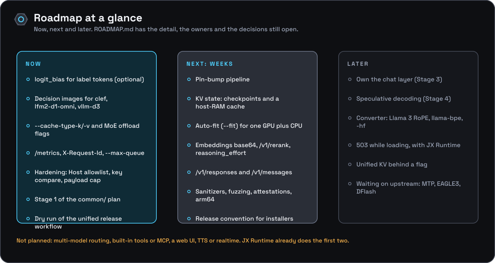

# Onyx Engine roadmap

What's next for Onyx Engine and what needs an owner decision, as of 2026-10-22. It summarises
the research reports, docs and open issues, and adds no scope of its own. **R1** is
[Onyx Engine improvement opportunities][R1] and **R2** is [Replacing llama cpp common code][R2].

## Where Onyx Engine stands

- **Version 0.6.0;** the last dated CHANGELOG release is 0.3.1, and `.release/README.md` records
  no dry run of the new release workflow yet.
- **llama.cpp pinned at b11820** (`d77256999`, 2026-10-22, the latest release when it moved);
  ggml pinned at `f1aa6a3` to match. CMake (or `npm ci`) fetches the source with Git; no Node is
  needed to build.
- **Implemented:** OpenAI-compatible chat, completions, embeddings and models; llama-server-style
  utility endpoints; SSE with `usage` and `timings`; Jinja templates and tool calls through
  `common/`; GBNF and `json_schema`; parallel slots with continuous batching; context shift;
  logprobs; reasoning budget; image and audio via `--mmproj`; per-slot prefix reuse; decision
  models on `/v1/systemone` ([#49][i49]); a numpy-only
  `LlamaForCausalLM` converter; `--api-key`; `503` while loading and `--port 0`; `/metrics`,
  `X-Request-Id`, `--max-queue` and `--tick-tokens`; base64 embeddings. Release binaries for
  nine platform variants (CPU, baseline x64, arm64 Linux, Vulkan) and a CPU Docker image.
- **Independent-tool plan:** items 1 to 8 of [`reports/independent-tool-plan.md`](reports/independent-tool-plan.md)
  landed in 0.6.0; item 9 (conformance suite, benchmarks, real-model nightly, sanitizers) is open.
- **How JX Runtime uses it:** its `onyxengine` adapter spawns one `onyx-engine` per loaded model,
  polls `/health`, proxies chat, completion and embeddings, probes `--help` before passing a
  flag, and installs release archives ([integration doc](docs/integration/jx-runtime.md)).

## Now

- **`logit_bias` for label tokens** ([#49][i49], optional): would make JX Runtime's chat-model
  decision shim cheaper; `logit_bias` still gets a 400. See [Decisions needed](#decisions-needed).
- **Decision images for clef, lfm2-d1-omni and vllm-d3:** these answer `501` today; they need media
  evaluated in the same batch as the text that reads it ([`docs/architecture/decision-models.md`](docs/architecture/decision-models.md)).
- **Memory flags:** `--cache-type-k/-v` and MoE offload (`--cpu-moe`, `--n-cpu-moe`, `-ot`), plain
  plumbing onto libllama. ([R1 ranking][R1-rank] #1; [R2 table][R2-table])
- **Operations:** done in 0.6.0 (`/metrics`, `X-Request-Id`, `--max-queue`, `--tick-tokens`).
  Still open: a queue-wait timeout. ([R1 ranking][R1-rank] #2–3)
- **Hardening:** the loopback Host allowlist, constant-time key compare, the explicit payload
  cap and the non-loopback `--host` refusal are done (0.6.0). Still open: a shorter read timeout
  and cpp-httplib v0.54.1 → v0.62. ([R1 hardening][R1-hard])
- **Stage 1 of the `common/` plan:** Onyx-owned tokenize, batch and log helpers and sampler,
  nlohmann JSON with a depth cap, a narrower SWA/recurrent reuse gate (`src/engine.cpp` line 113)
  and a thin chat seam. 1–1.5 weeks. The b11820 bump already brought Onyx batch helpers
  (`onyx_batch_add`, since upstream removed `common_batch_add`) and a part-aware prompt tokenizer
  for common's new `common_chat_prompt`; the rest still applies. ([R2 stages][R2-stages])
- **Song Deck structured output (its M1):** run Song Deck's real schemas through `json_schema` →
  GBNF and make truncated JSON fail clearly. ([Song Deck plan][SD-onyx], step 1)
- **First release from the unified workflow:** dry-run it, then publish. The publisher bug that
  failed the v0.4.1 and v0.5.1 runs is fixed by the infrastructure pin in 0.6.0; delete their
  empty drafts and tags. The docs describe the manual, dry-run-first flow
  ([`docs/development/releasing.md`](docs/development/releasing.md)).

## Next: weeks

- **Pin-bump pipeline:** a scheduled Action that updates the vendor specs and opens a PR with the
  `common/` header diff. (The bump to b11820 itself was done by hand for #49.)
  ([R1 ranking][R1-rank] #9)
- **KV state (Stage 2):** context checkpoints and a host-RAM prompt cache, so SWA and hybrid
  models (Gemma 4, gpt-oss, Qwen3.5, Granite 4) get prefix reuse again; then slot save/restore and
  media-aware matching under `--mmproj`. 2.5–3.5 weeks; the b11820 pin carries upstream's
  checkpoint fixes. ([R2 KV][R2-kv])
- **Auto-fit (`--fit`)** for one GPU plus CPU, alongside Stage 2. It reads memory through the
  unstable `src/llama-ext.h`, so it needs a fallback estimate. ([R2 table][R2-table])
- **Client compatibility:** embeddings `dimensions` (`base64` landed in 0.6.0), `/v1/rerank` over
  `--pooling rank`, `reasoning`/`reasoning_effort`, `allowed_tools` and `strict` tools, and context
  length in `/v1/models`. ([R1 API][R1-api]; [ranking][R1-rank] #5)
- **`/v1/responses` and `/v1/messages`** for Codex and Claude Code, 1–2 weeks each; JX Runtime
  needs new `KIND_PATHS` entries to route them. ([R1 API][R1-api])
- **CI and distribution:** an ASan/UBSan smoke-test job, fuzz harnesses, an RPC-off assertion,
  build attestations and immutable releases (baseline-x64, arm64 Linux and Vulkan builds landed
  in 0.6.0). ([R1 hardening][R1-hard])
- **Release convention** (`docs/release-convention.md`) for JX Runtime's installer and the audio
  apps, before Song Deck's M3. ([Song Deck plan][SD-onyx], step 2)

## Later

- **Own the chat layer (Stage 3):** copy upstream's Jinja engine and schema converter, write
  per-family tool-call and reasoning parsers, then set `LLAMA_BUILD_COMMON=OFF`. 4–7 weeks; its
  scope is decision 2. ([R2 chat layer][R2-chat])
- **Speculative decoding (Stage 4):** a verifier and adaptive n-gram drafting with a per-slot kill
  switch; an opt-in draft model later. Needs only the Stage 1 sampler, so it can run beside
  Stage 3. ([R2 speculation][R2-spec])
- **Converter:** accept Llama 3 RoPE and the `llama-bpe` pre-tokenizer, rebase on the vendored
  `gguf-py`, and prefer pre-quantized GGUFs through an `-hf` resolver. ([R1 converter][R1-conv])
- **Unified KV** behind a flag, so `-np N` stops splitting the context.
- **Waiting on upstream:** MTP, EAGLE3 and DFlash (until their API reaches `llama.h`), and
  `GGML_BACKEND_DL` GPU variants. **Not planned:** multi-model routing, built-in tools or MCP,
  a web UI, TTS and realtime, which duplicate JX Runtime's role. ([R1 ranking][R1-rank])

## Open issues and PRs

| Item | What it needs | Where it sits |
|---|---|---|
| [#49][i49] decision models (`/v1/systemone`) | Close once 0.5.0 merges; `logit_bias` stays optional | Option (a) done: llama.cpp re-vendored to b11820 and the handler ported (`src/decision.cpp`) |
| Dependabot: `actions/cache`, `download-artifact`, `upload-artifact`, `setup-node` | Nothing; they close when 0.5.0 merges | Their bumps are folded into 0.5.0. Alone they failed `versions / validate`: a workflow change has to advance the onyx-engine version, which Dependabot cannot do |
| QA follow-up to #46, #47, #51 (closed) | `browser_qa: { enabled: false }` for Onyx Engine in QAI-ality's `config/apps.yml` | QA runner config, outside this repo; gives levels 8–11 and 13 a clean SKIP |
| #35, #36 (closed) | Nothing | Fixed on main: `npm ci` fetches llama.cpp with Git |

## Decisions needed

1. **#49, `logit_bias` for label tokens.** Option (a) is done (0.5.0): llama.cpp at b11820 and
   `/v1/systemone` in Onyx code. BackTrack's ggml pin should move to `f1aa6a3` with it. Still open:
   whether to accept `logit_bias` restricted to label tokens, so a chat model can serve the
   decision shim with an enum constraint plus logprobs.
2. **How far to own the chat layer.** Full Stage 3 drops `common/` but loses automatic support for
   new chat templates; keeping upstream's chat layer behind the seam costs 3–5 days once and
   0.5–2 days per pin bump. ([R2 chat layer][R2-chat])
3. **Speculative decoding.** The README lists it as not yet implemented; both reports recommend adaptive
   n-gram drafting, R1 through `common_speculative_*`, R2 through Onyx's own verifier on
   `llama.h`. For MTP: wait for `llama.h` (R2's pick) or write a driver limited to `-np 1` now.
4. **Converter.** Fix and rebase the numpy converter, fall back to upstream's
   `convert_hf_to_gguf.py` when torch is present, or lean on pre-quantized GGUFs; and whether the
   `-hf` resolver lives in Onyx or in JX Runtime.
5. **Release builds and signing.** Baseline-x64, arm64 Linux and Vulkan variants shipped in
   0.6.0 as separate archives; still open: `GGML_BACKEND_DL` runtime CPU dispatch instead, CUDA
   or ROCm archives, Metal in the `darwin-arm64` archive, a published arm64 or CUDA image; whether to pay for Windows Authenticode (about
   €8.60 a month) and macOS notarization.
6. **JX Runtime:** 503-while-loading readiness and the non-loopback `--host` refusal shipped in
   0.6.0 without needing a JX change (its `_waitReady()` treats only `200` as ready, and it binds
   `127.0.0.1`). Still open: whether JX's idle unload makes `--sleep-idle-seconds` moot.
7. **llguidance for faster grammars.** R1 defers a build with it; R2 rules it out (Rust toolchain).

## Cross-repo dependencies

- **[JX Runtime](https://github.com/jxburros/JX-Runtime)** spawns and proxies Onyx Engine and
  installs its release archives by tag and asset name. Responses and Messages routing, #49 and
  the pinned release tag need changes there too.
- **[BackTrack](https://github.com/jxburros/BackTrack)** vendors ggml with Onyx's scripts (it was
  last at `36da571`; Onyx now pins `f1aa6a3`). After a llama.cpp bump, run
  `scripts/check-ggml-pin.sh ../BackTrack/packaging/vendor/ggml.conf` and move both pins.
- **[Song Deck](https://github.com/jxburros/Song-Deck)** reaches local models through JX Runtime,
  so its schema-constrained JSON lands in Onyx's `json_schema` → GBNF path.

## Planning documents

| Document | Covers | Current? |
|---|---|---|
| [R1][R1] | What to port from llama-server, hardening, API surfaces, converter; ranked by value and effort | Yes (2026-10-21, against b10711) |
| [R2][R2] | Replace, copy or keep for each `common/` piece; the four-stage plan | Yes (2026-10-21) |
| `research_notes/Onyx Engine improvement opportunities/` | Five notes: API standards, engineering and security, models and conversion, serving, upstream | Yes; evidence for R1 |
| `research_notes/Replacing llama cpp common code/` | Four notes: chat and tools, KV-cache state, sampling/grammar/fit, speculative decoding | Yes; evidence for R2 |
| [`docs/`](docs/README.md) | The documentation home: guides, reference, architecture, integration, development | Yes; reorganised 2026-10-22 and checked against `src/args.cpp` and `src/server.cpp` |
| [`docs/architecture/`](docs/architecture/README.md) | Process model, batching loop, prefix reuse, multimodal, build layering | Yes; describes today's `common/` use |
| [`docs/reference/api/`](docs/reference/api/README.md) | Request and response shapes per endpoint | Yes |
| [`docs/development/`](docs/development/README.md) | Builds, acceleration, CI, vendor packages, releases | Yes; the release page describes the unified workflow |
| [`docs/integration/jx-runtime.md`](docs/integration/jx-runtime.md) | The contract JX Runtime's adapter relies on | Yes |
| [`.ai/qa.md`](.ai/qa.md), [`.ai/qa.yaml`](.ai/qa.yaml) | QA levels for the nightly runner | Yes |
| [`.release/README.md`](.release/README.md) | Unified release setup and what is still unverified | Yes (2026-10-20) |
| [`README.md`](README.md#tolerances) tolerances | What Onyx won't do | Yes |
| Song Deck [`docs/plans/onyx-engine.md`][SD-onyx] | Structured output, release convention, reusable vendoring, converter | Partly: written at 0.4.0; reusable vendoring is done |
| Song Deck [`docs/plans/jx-runtime.md`][SD-jx] | JX Runtime as Song Deck's runtime, then audio engines | Context; its M1 is done |

[R1]: reports/Onyx%20Engine%20improvement%20opportunities.md
[R1-api]: reports/Onyx%20Engine%20improvement%20opportunities.md#two-translation-layers-would-unlock-todays-agent-clients
[R1-hard]: reports/Onyx%20Engine%20improvement%20opportunities.md#hardening-and-packaging-gaps-are-small-cheap-and-concrete
[R1-conv]: reports/Onyx%20Engine%20improvement%20opportunities.md#the-converter-covers-almost-nothing-so-change-strategy
[R1-rank]: reports/Onyx%20Engine%20improvement%20opportunities.md#ranking-the-opportunities-by-value-against-effort
[R2]: reports/Replacing%20llama%20cpp%20common%20code.md
[R2-table]: reports/Replacing%20llama%20cpp%20common%20code.md#what-to-replace-copy-or-keep
[R2-stages]: reports/Replacing%20llama%20cpp%20common%20code.md#the-staged-plan-to-unlink-common
[R2-kv]: reports/Replacing%20llama%20cpp%20common%20code.md#kv-state-is-a-port-of-llama-server-not-of-common
[R2-chat]: reports/Replacing%20llama%20cpp%20common%20code.md#the-chat-layer-is-a-hybrid-copied-engine-owned-parsers
[R2-spec]: reports/Replacing%20llama%20cpp%20common%20code.md#speculation-is-owned-in-two-stages-mtp-waits
[i49]: https://github.com/JX-Holdings-LLC/Onyx-Engine/issues/49
[SD-onyx]: https://github.com/jxburros/Song-Deck/blob/main/docs/plans/onyx-engine.md
[SD-jx]: https://github.com/jxburros/Song-Deck/blob/main/docs/plans/jx-runtime.md
