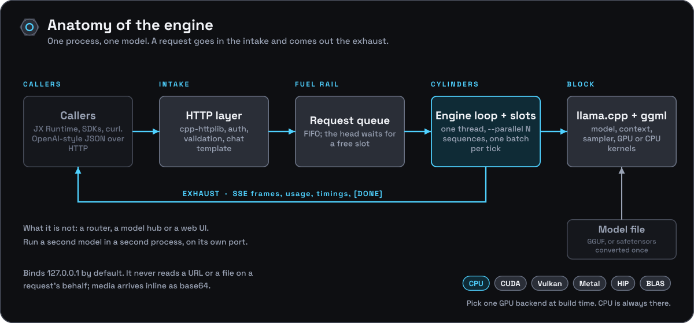
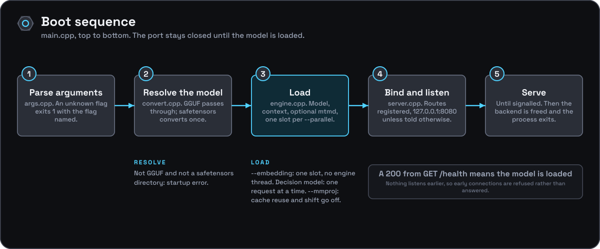
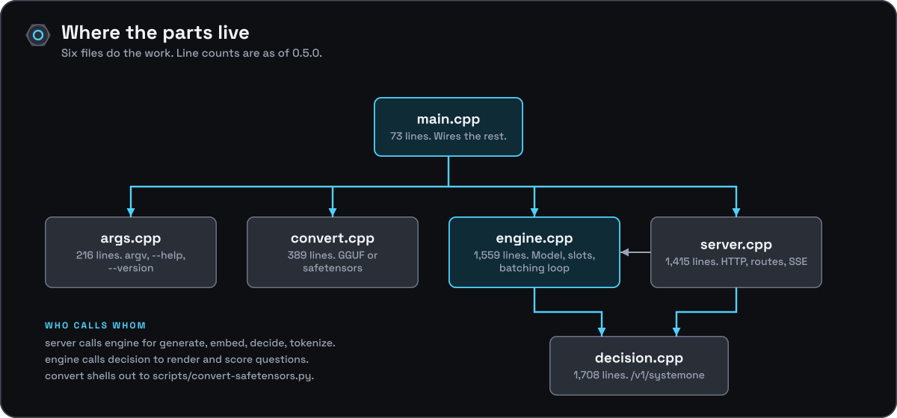

[Documentation](../README.md) › Architecture

# Architecture

How the engine is put together, written for someone who has to open the hood. Start here, then follow the part you need.

## Process model

`onyx-engine` is a single-model, single-process server. Each process:

1. parses its command line (`src/args.cpp`),
2. resolves the model: a GGUF passes through, a safetensors model is converted once and cached (`src/convert.cpp`),
3. loads exactly one model and creates one `llama_context` (`onyx_engine::load` in `src/engine.cpp`),
4. blocks in an HTTP server loop until it is signalled (`onyx_server_run` in `src/server.cpp`).

There is no in-process model swapping and no multi-model registry. Running more than one model means running more than one `onyx-engine` process, each on its own port. That is deliberate: the intended caller, JX Runtime, already manages one child process per loaded model (see [the integration notes](../integration/jx-runtime.md)), so the engine does not duplicate that bookkeeping.

## Source layout

| File | Responsibility |
|---|---|
| `src/args.h` / `src/args.cpp` | `onyx_args` struct, `argv` parsing, `--help` and `--version` text |
| `src/convert.h` / `src/convert.cpp` | `onyx_resolve_model()`: GGUF passthrough versus safetensors detection, conversion and caching ([details](safetensors-conversion.md)) |
| `src/decision.h` / `src/decision.cpp` | `onyx_decision`: decision-model ("System One") support behind `/v1/systemone`: family detection from `<arch>.decision.type`, request parsing, prompt rendering with the model's `systemone` template, and turning raw outputs into answers ([details](decision-models.md)) |
| `src/http_util.h` / `src/http_util.cpp` | Request helpers with no engine dependency: media payload and base64 decoding, base64 embeddings, the `X-Request-Id`, API-key and `Host` checks. Unit-tested in `tests/unit/` |
| `src/llama_util.h` / `src/llama_util.cpp` | Onyx-owned helpers on the public `llama.h` API: tokenize, detokenize, token-to-piece, `llama_batch` filling, and the stderr log filter (llama.cpp, ggml and mtmd). Stage 1 of the [`common/` plan](../../reports/Replacing%20llama%20cpp%20common%20code.md); they replace `common_tokenize`, `common_detokenize`, `common_token_to_piece` and `common_batch_add` |
| `src/engine.h` / `src/engine.cpp` | `onyx_engine`: owns the llama.cpp model and context (and the optional mtmd context), runs the batching loop, generation and embedding, tokenize and detokenize helpers ([details](concurrency.md)) |
| `src/server.h` / `src/server.cpp` | The HTTP layer on `cpp-httplib`: request parsing, response and SSE-frame construction, every route handler |
| `src/main.cpp` | Entry point: parse arguments, initialize the llama.cpp backend, then hand `onyx_server_run` a load step (resolve, convert, load) that runs while the server already answers `503` |

`server.cpp` depends on `engine.h` (to call generation, embedding and tokenize) and on llama.cpp's `common` headers (`chat.h`, `common.h`, `json.h`, `json-schema-to-grammar.h`, `sampling.h`, `log.h`) for chat templating, JSON, grammar construction and sampling parameter types. `engine.cpp` depends directly on `llama.h`, the core C API, plus `common.h` and `sampling.h` (the sampler and grammar are still `common_sampler`). Tokenization and batch filling go through `llama_util.h` everywhere, so `common/`'s tokenize helpers are no longer called.

## The parts, one page each

| Page | Covers |
|---|---|
| [Concurrency and batching](concurrency.md) | One engine thread, slots, the batching tick, streaming, cancellation |
| [KV cache](kv-cache.md) | Prefix reuse between requests, context shift within one |
| [Multimodal input](multimodal.md) | The marker rewrite, media prefill, and why it stalls the loop |
| [Decision models](decision-models.md) | `/v1/systemone`: load, prompts, evaluation, images, answers |
| [Safetensors conversion](safetensors-conversion.md) | How `-m` is resolved and the converter's limits |
| [Reasoning budget and logprobs](reasoning-and-logprobs.md) | Two per-token features in the sampling step |
| [Chat templates, grammar and sampling](chat-templates-and-sampling.md) | What comes from llama.cpp's `common` library |
| [Build layering](build-layering.md) | What the binary links, where the source comes from, the pin string |

For where the design is heading, see the [roadmap](../../ROADMAP.md) and the two reports behind it in [`reports/`](../../reports/README.md).
