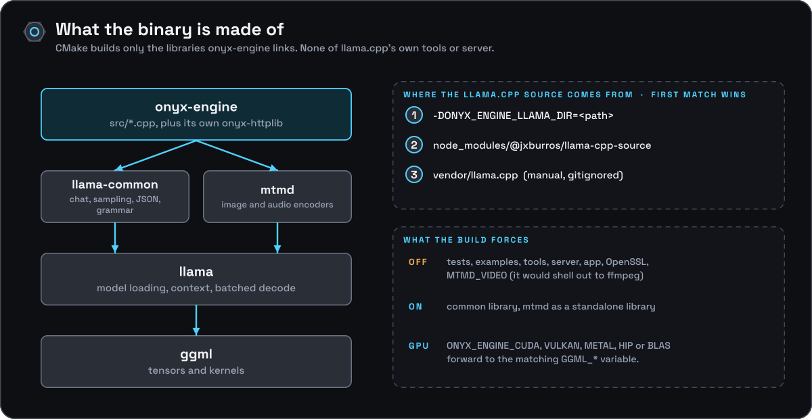

[Documentation](../README.md) › [Architecture](README.md) › Build layering

# Build layering



```
onyx-engine (src/*.cpp)
    │  target_link_libraries: llama-common, llama, mtmd, Threads::Threads
    ▼
llama-common ─┐        (<llama src>/common — chat templating, sampling,
    │         │         JSON, grammar-to-schema, tokenization helpers)
    │     mtmd│        (<llama src>/tools/mtmd — multimodal projector:
    │         │         image/audio encoders, marker handling; built via
    │         │         LLAMA_BUILD_MTMD=ON, add_subdirectory()'d directly
    │         │         without the rest of tools/, which stays unbuilt)
    ▼         ▼
llama                 (<llama src> — the core inference library:
    │                   model loading, context, batched decode)
    ▼
ggml                  (<llama src>'s tensor/compute library; CPU by
                        default, CUDA/Vulkan/Metal/HIP/BLAS backends
                        selected via GGML_* CMake cache variables that
                        ONYX_ENGINE_CUDA/VULKAN/METAL/HIP/BLAS forward)
```

`<llama src>` is the llama.cpp source tree `CMakeLists.txt` resolves at
configure time, in this order:

1. `-DONYX_ENGINE_LLAMA_DIR=<path>` — explicit override
2. `node_modules/@jxburros/llama-cpp-source` — the Git source fetched by
   `npm ci` (canonical path; see [`building.md`](../development/building.md))
3. `vendor/llama.cpp` — a manually placed source tree (gitignored, fallback
   only)

The build's external source is an exact llama.cpp Git commit. Nothing under
`vendor/` is tracked by this repository or fetched automatically — it exists
only as a manual escape hatch.
`CMakeLists.txt` builds only the llama.cpp libraries it needs:
`LLAMA_BUILD_TESTS`, `LLAMA_BUILD_EXAMPLES`, `LLAMA_BUILD_TOOLS`,
`LLAMA_BUILD_SERVER`, and `LLAMA_BUILD_APP` are all forced `OFF` (so
upstream's own `llama-server`, its app binary, and example binaries are
never built), `LLAMA_BUILD_COMMON` is forced `ON` (so the `common` library
`onyx-engine` depends on is available), and `LLAMA_OPENSSL` is forced `OFF`.
`LLAMA_BUILD_MTMD` is forced `ON` — upstream's escape hatch for building
`tools/mtmd` as a standalone library directly (`add_subdirectory()`)
without going through `tools/CMakeLists.txt` and the rest of the (still-off)
tools tree — giving `onyx-engine` multimodal projector support without
building any of upstream's own CLI tools. `MTMD_VIDEO` is forced `OFF`:
mtmd's video path shells out to an `ffmpeg` binary at runtime, and
`onyx-engine` takes no runtime dependency on external processes.
`onyx-engine`'s include paths pull from exactly two places in that tree:
`<llama src>/common` and `<llama src>/tools/mtmd`. Of `common/`, only the
chat seam (`src/onyx_chat.cpp`: chat, Jinja, the schema converter) and
`src/decision.cpp` (`common.h`'s string helpers) include anything, plus
`src/llama_util.cpp` for the log threshold.

JSON in Onyx's own code is `nlohmann::ordered_json` from
[`third_party/nlohmann`](../../third_party/nlohmann) (the header-only 3.12.0 copy the pin
vendors, byte for byte, with its deep-nesting backport), reached through
`src/onyx_json.h`. Values cross into `common/`'s `common_json` as text, in the
chat seam only.

`cpp-httplib` (the HTTP server used in `server.cpp`) is **not** one of them
any more. It is onyx-engine's own vendored copy under
[`third_party/cpp-httplib`](../../third_party/cpp-httplib), compiled here as the
`onyx-httplib` static target. It used to be an include path into
`<llama src>/vendor/cpp-httplib`, with the implementation coming out of
`libllama-common.so` — which links upstream's own cpp-httplib statically and
re-exports ~1200 `httplib::*` symbols. That made onyx-engine's HTTP layer
depend on a private implementation detail of `llama-common`, and it meant the
tuning macros upstream sets `PRIVATE` on its target (notably
`CPPHTTPLIB_TCP_NODELAY`, a default member initializer of `httplib::Server`)
applied to `httplib.cpp` but not to `server.cpp` — an ODR mismatch, latent
rather than live, since the value that took effect came from the out-of-line
constructor in `httplib.cpp`. Both go away with a local copy whose macros are
`PUBLIC`. `onyx-httplib` is deliberately listed **first** on the link line,
ahead of `llama-common`, so no httplib symbol resolves to llama.cpp's shared
library; see that directory's `README.md`.

## The llama.cpp pin string

`--version` and `/props`'s `build_info` report which llama.cpp the binary was
built against. This does **not** come from upstream's `llama_build_info()`.
Upstream's `cmake/build-info.cmake` runs `git rev-parse` with the llama.cpp
source directory as the working directory; in the canonical build that
directory is `node_modules/@jxburros/llama-cpp-source`, which has no `.git` of
its own, so git walks up and finds **onyx-engine's** repository instead —
reporting onyx-engine's own commit and commit count as llama.cpp build info
(before this was fixed, a build at onyx-engine commit `c0394c2` reported
`b20-c0394c2`).

`CMakeLists.txt` derives `ONYX_ENGINE_LLAMA_PIN` from the single commit pin in
`packaging/vendor/llama.cpp.conf` and checks the installed source stamp or
package metadata before compiling the node_modules tree.
