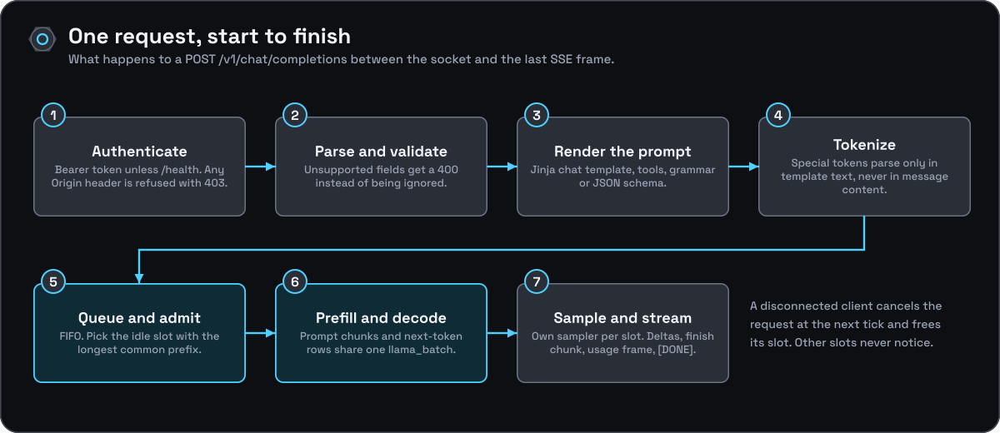
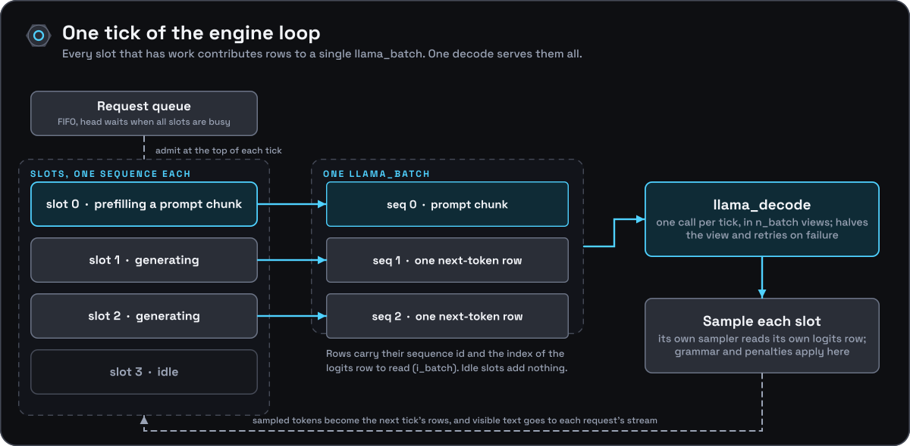
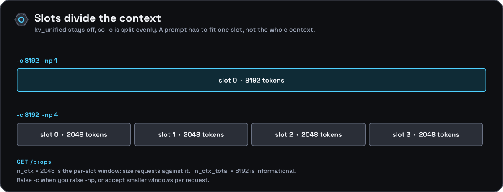

[Documentation](../README.md) › [Architecture](README.md) › Concurrency and batching

# Concurrency and batching

## One request, start to finish

A request is parsed and validated on an HTTP worker thread, handed to the engine thread through a FIFO queue, decoded inside a shared batch, and streamed back by the worker that is waiting on it. The rest of this page takes those pieces in the order a request meets them.

## The engine loop

## The tick budget

`build_batch` fills each tick in a fixed order: **decode rows first**, one for every generating
slot, then prompt chunks for the slots still prefilling, split evenly between them. Without
`--tick-tokens` the tick is bounded only by `--batch-size` (default 2048), so a long prompt
arriving while others stream makes every streaming slot's next token wait for up to 2048 prompt
tokens of compute.

`--tick-tokens N` caps the whole tick, decode rows included, at `N` tokens (and never above
`--batch-size`). The prompt chunks share whatever the decode rows leave, with at least one token
per tick, so prefill always makes progress even when the decode rows alone reach `N`. A small
budget (say 256 on a CPU host) keeps inter-token latency flat while prompts arrive, at the cost
of slower prefill. This is the "decodes first, then fill a token budget" schedule that vLLM and
Sarathi-Serve use. It does not touch multimodal prefill, which runs inline at admission (see
[multimodal](multimodal.md)).

## Admission and the queue

Requests that find every slot busy wait in a first-in, first-out queue. By default the queue has
no limit. `--max-queue N` bounds it: when `N` requests are already waiting, `generate()` refuses
the next one at once, and the HTTP layer answers `503` (`unavailable_error`) with
`Retry-After: 1`. A streaming handler checks the same limit before it starts the stream, so the
refusal is an HTTP status rather than an error frame. A request that loses the race between that
check and the queue gets a single `503` error frame instead. `/metrics` reports the queue length
(`llamacpp:requests_deferred`) and the refusals (`onyx:requests_rejected_total`).

## Slots and context

## Details

- **One engine thread, `--parallel` request slots, continuous batching.**
  `onyx_engine::load` creates the context with `n_seq_max = n_parallel` and
  allocates that many `onyx_slot`s; slot `i` owns llama.cpp sequence id `i`.
  A dedicated thread (`onyx_engine::loop`) ticks: it admits queued requests
  into idle slots, packs **one** `llama_batch` holding a prompt chunk for
  each slot still prefilling plus exactly one next-token row for each
  generating slot (each row tagged with that slot's sequence id, and the
  slot's logits row index recorded in `onyx_slot::i_batch`), issues a single
  `llama_decode` for it (split into `n_batch`-sized views, halving the view
  size and retrying on `llama_decode() == 1`, fatal at size 1), and then
  samples each slot from its own `common_sampler` at its own row. `kv_unified`
  stays at llama.cpp's default `false`, so `n_ctx` is divided evenly across
  the slots: the per-slot budget is `llama_n_ctx_seq()`
  (`onyx_engine::n_ctx_slot()`), and that — not `n_ctx` — is what a prompt has
  to fit into.
- **HTTP layer is multi-threaded; requests queue FIFO.** `onyx-engine` uses
  `cpp-httplib`'s (`httplib::Server`) built-in thread pool. `generate()` is
  a blocking call, but it submits a `onyx_gen_request` to the engine
  queue and waits on it instead of holding a global lock, so up to
  `--parallel` requests generate concurrently. When every slot is busy the
  head of the queue waits and nothing behind it jumps ahead. `embed()` still
  takes `onyx_engine::mutex_` and runs serialized: embedding mode forces
  `n_parallel = 1` and starts no engine thread.
- **Streaming is one SSE write callback, fed by a per-request queue.**
  Chat/text completion streaming uses `httplib::Response::set_chunked_content_provider`.
  The provider lambda is called once (`offset == 0`) and does all its work —
  including the whole blocking `engine.generate()` call — inside that one
  invocation. The engine thread only ever *pushes* visible text into the
  request's `pieces` deque; the HTTP thread blocked in `generate()` pops from
  it and invokes the token callback (`onyx_token_cb`), which is what writes
  each SSE frame. So a slow or stalled client can only back up its own
  request, never the engine loop or the other slots.
- **Cancellation.** The token callback returns `bool`; returning `false`
  (e.g. because `sink.write()` failed, meaning the client disconnected) marks
  the request cancelled. The engine loop notices at the top of its next tick,
  finishes that request with `onyx_gen_result::finish = ONYX_FINISH_CANCEL` and
  releases its slot. Other slots are unaffected.
