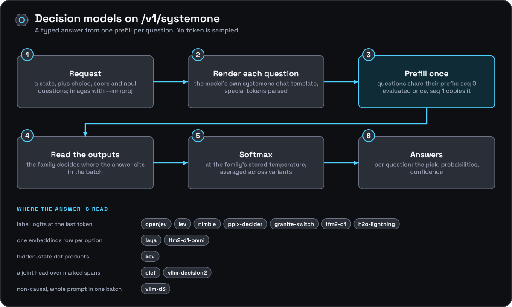

[Documentation](../README.md) › [Architecture](README.md) › Decision models

# Decision models

## What a decision model is

A GGUF with `<arch>.decision.type` in its metadata is a decision model: it
answers typed questions (`choice`, `score`, `noul`) about a state from one
prefill per question, with no generation. llama.cpp added this as
llama-server's `/v1/systemone` after the old pin (#29818); onyx-engine
re-implements the handler on its own HTTP layer, following llama-server's
`server-decision.cpp` at the vendored pin. The model graphs (decision heads,
labels) are libllama's.

## Load

`onyx_engine::load` reads the family with
`onyx_decision_type_of()` (its own metadata read, not common's) before
creating the context. A decision model gets **decision mode**: one request
at a time, no batching loop, `n_seq_max = 2` with a unified KV cache (both
sequences see the whole `-c`). Families that answer from embeddings rows
(laya, kev, clef, lfm2-d1-omni, vllm-decision2) get `embeddings = true`,
no pooling, and `n_ubatch = n_batch`; the label families get
`n_outputs_max = n_seq_max`, as llama-server sizes it. `--embedding` with a
decision model is a load error. An unknown family, or a model without a
`systemone` chat template, fails the load.

## Prompts

`onyx_decision` (`src/decision.cpp`) parses the request,
renders each question with the model's `systemone` template (common's
Jinja engine), tokenizes it with special tokens parsed, as llama-server
does, and records where its answer is read: label logits at the last
token, embeddings rows at marker positions, or a joint head's first rows
with `llama_batch_ext_set_decision_order` marking its spans. lev shows a
choice's options in both orders and averages them. clef puts every
question of a request in one prompt.

## Evaluation

`onyx_engine::decide()` uses `llama_batch_ext` and
`llama_process()`. Everything before the first position read goes in
`--batch-size` chunks; from there to the end is one batch, so the outputs
sit together (non-causal families: the whole prompt in one batch). For
causal families the questions of a request share their prompt prefix:
it is evaluated once into seq 0, then each question runs in seq 1 from a
`llama_memory_seq_cp` copy, which works for recurrent and hybrid memory
too. Seq 0 keeps that prefix for the next request (longest common prefix,
falling back to a fresh start when the memory cannot be cut back);
`--cache-reuse 0` turns this off.

## Images

For the label families (openjev, pplx-decider, lfm2-d1,
h2o-lightning) a prompt with images is tokenized and prefilled by mtmd
into a cleared seq 0, and the labels are read from the last row. clef,
lfm2-d1-omni and vllm-d3 read positions after the media or need the whole
prompt in one non-causal batch, which mtmd's chunk-by-chunk prefill does
not give; they answer image requests with `501`.

## Answers

Softmax over each prompt's outputs at the family's stored
temperature (by question type and option count), averaged across
variants, then the TypeSafe confidence formulas.

Checked against llama-server built from the same pin on ggml-org's
tinyopenjev (with its projector) and tinylaya test models: with `-fa off`
the answers are identical; with flash attention they agree to about 1e-3,
since the kernel's accumulation order follows the batch layout, which
differs between the two servers (and between llama-server's own `-np 1` and
`-np 2`). `scripts/smoke-test.sh` covers the openjev path offline with a
generated tiny model (`make-tiny-model.py --decision`).
