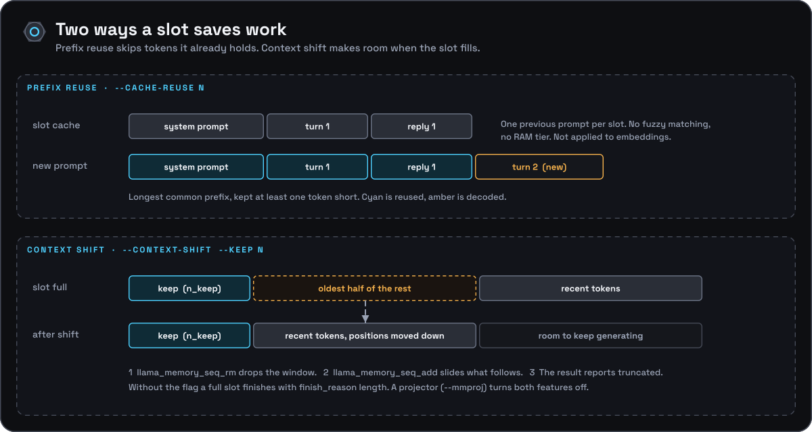

[Documentation](../README.md) › [Architecture](README.md) › KV cache: prefix reuse and context shift

# KV cache: prefix reuse and context shift

Each slot owns one sequence in the KV cache. Two features keep that cache useful: reuse skips tokens the slot already holds, and shift makes room when it fills. Both are switched off, process-wide, by `--mmproj`.

## Context shift

With `--context-shift`, a generating slot that would otherwise stop at its
per-slot context limit instead drops the oldest half of its non-preserved
context and keeps going (`onyx_engine::context_shift`, mirroring
`llama-server`):

1. `n_keep` comes from `--keep` (`-1` = the whole prompt), `+1` if the vocab
   adds BOS, capped to `n_ctx_slot - 4`.
2. `n_discard = (n_past - n_keep) / 2`, clamped to `[0, n_left - 1]`.
3. `llama_memory_seq_rm(mem, seq, n_keep, n_keep + n_discard)` then
   `llama_memory_seq_add(mem, seq, n_keep + n_discard, n_past, -n_discard)`
   drop that window and shift everything after it down, and the slot's
   `cache_tokens` mirror is compacted the same way.
4. `onyx_gen_result::truncated` is set; generation continues.

Without `--context-shift` (the default) the request finishes with
`ONYX_FINISH_LENGTH` at the context limit. If the loaded
context cannot shift (`llama_memory_can_shift()` is false, e.g. sliding-window
attention), `load()` forces the flag off with a warning on stderr — as does
loading a `--mmproj` projector (see
[Multimodal input](multimodal.md) below).

## KV-cache prefix reuse

Each slot keeps a copy of the token sequence currently materialized in *its*
sequence's KV cache (`onyx_slot::cache_tokens`). When the engine loop admits a
queued request (`onyx_engine::admit_queued`):

1. It scans the idle slots and picks the one whose `cache_tokens` share the
   longest common prefix with the new prompt — capped so at least one token
   is always left to evaluate fresh (so there is always something to compute
   logits from). Ties, and the case where reuse is off, fall back to the
   least-recently-used idle slot.
2. If that common-prefix length is at least `--cache-reuse` (default `1`,
   `0` disables reuse entirely), that slot's cache is trimmed to the prefix
   (`llama_memory_seq_rm`) and only the remaining, differing suffix of the
   prompt is decoded.
3. Otherwise the slot's sequence is dropped entirely
   (`llama_memory_seq_rm(mem, seq, -1, -1)`) and the whole prompt is decoded
   from scratch.

Whether a slot's state can be cut back to that prefix depends on the memory
type. At load, generation mode probes it (`onyx_probe_seq_rm` in
`src/llama_util.cpp`, the port of `common_context_can_seq_rm`): it decodes two
tokens, tries to remove the second and reports `partial`, `full`, `bounded` or
`none` (`/props` `memory_seq_rm`). With `full` (recurrent state, no rollback)
a slot only counts as a match when the new prompt extends all of its cached
tokens, so slot choice prefers the slot whose state can actually be extended
over one that merely shares more tokens; with `none` there is no reuse. The
rest is decided per request with llama-server's rule rather than once per
process. Before trimming, the engine reads the sequence's lowest position
(`llama_memory_seq_pos_min`). The first new token sits at position `prefix`;
with a pruned sliding-window cache it attends to the positions after
`prefix - n_swa`, so the state is usable when it still starts at or before
`prefix - n_swa + 1`. Any other memory must not reach past the prefix at all:
a recurrent (Mamba, RWKV) or hybrid state holds only its last position, so it
is reused only when the new prompt extends the cached tokens exactly, as the
next turn of a chat does. If the test fails, or `llama_memory_seq_rm` refuses
the cut, the slot starts from scratch. The engine keeps llama.cpp's default
`swa_full`, a full-size sliding-window cache that is never pruned, so on
sliding-window models (Gemma, gpt-oss) prefix reuse works as it does on dense
ones, at the cost of a KV cache sized like a dense model's. Until 0.7.0 the
engine turned reuse off for every sliding-window or recurrent model at load.
Restoring an older point of a recurrent state (context checkpoints) is Stage 2
of the [`common/` plan](../../reports/Replacing%20llama%20cpp%20common%20code.md).

This is a plain longest-common-prefix match against the most recently decoded
prompt *of each slot* — not a cache of multiple past prompts per slot, no
similarity/fuzzy matching, and no RAM tier. It exists to make repeated calls
that share a long, unchanged prefix (e.g. a growing chat transcript, or the
same system prompt across many requests) cheaper, at the cost of the linear
scan and the memory of holding one previous token sequence per slot.

`onyx_gen_result` reports `n_cached` (tokens reused) and `n_prompt` (total
prompt tokens) so callers can see how much was actually reused; the
`/v1/chat/completions` and `/v1/completions` responses surface these via the
`timings` object (`cache_n`, `prompt_n` = `n_prompt - n_cached`).

`embed()` always clears the KV cache first — prefix reuse does not apply to
embedding requests. Loading a `--mmproj` projector force-disables
`--cache-reuse` process-wide (see
[Multimodal input](multimodal.md) below) — a media chunk's KV
positions cannot be prefix-matched token-by-token.
