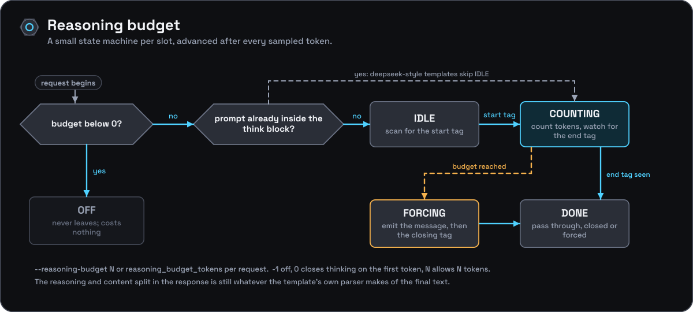

[Documentation](../README.md) › [Architecture](README.md) › Reasoning budget and logprobs

# Reasoning budget and logprobs

Two features that live in the sampling step: a per-slot state machine that bounds a thinking model's `<think>` block, and raw-probability capture for `logprobs`.

## Reasoning budget (`--reasoning-budget`)

Own-code state machine, not a llama.cpp sampler feature — `onyx_slot::rb_state_t`
runs per slot, driven by `on_sampled()` after every token:

- **`RB_OFF`** — no budget in effect for this request (`reasoning_budget <
  0`, the default). `build_reasoning_budget()` in `server.cpp` resolves the
  effective budget (`--reasoning-budget`, overridden per-request by
  `reasoning_budget_tokens`) and the template's own thinking tags
  (`cp.thinking_start_tag`/`thinking_end_tags[0]`, falling back to
  `<think>`/`</think>`) once per request; a negative budget short-circuits
  to a default-constructed (disabled) `onyx_reasoning_budget` and the slot
  never leaves `RB_OFF`.
- **`RB_IDLE`** — scanning newly generated tokens for the start tag via a
  rolling multi-token match (`rb_start_match`). A template whose rendered
  generation prompt already ends inside the thinking block (deepseek-style,
  detected textually by `build_reasoning_budget()` via `start_in_prompt`)
  skips straight to `RB_COUNTING` instead.
- **`RB_COUNTING`** — counting generated tokens (`rb_count`) while also
  rolling-matching the end tag (`rb_end_match`); reaching the end tag
  naturally moves to `RB_DONE`, reaching the budget first moves to
  `RB_FORCING`.
- **`RB_FORCING`** — instead of sampling, tokens are emitted one at a time
  from `onyx_reasoning_budget::forced` (`rb_forced_idx`) — the configured
  `--reasoning-budget-message` (if set and budget > 0) followed by the
  closing tag; budget `0` forces the closing tag immediately with no
  message.
- **`RB_DONE`** — passthrough forever after, whether the block closed
  naturally or was forced.

The response text is not otherwise special-cased: `common_chat_parse()`
still derives whatever reasoning/content split the template's own parser
produces from the final text.

## Logprobs

Captured inline during sampling, not as a post-hoc pass: `sample_slot()`
calls `compute_token_probs()` (`src/engine.cpp`) whenever the request set
`want_logprobs`, reading `llama_get_logits_ith(ctx_, tok_idx)` — the raw
logits row for the token about to be sampled, from the same batch row
`onyx_slot::i_batch` recorded during `build_batch()` — and running a single
numerically-stable full-vocab softmax over it. This is deliberately the
*raw* model distribution, computed before any sampler-chain transform
(grammar, top-k/top-p/min-p, penalties), so a grammar-constrained or
otherwise heavily-steered pick still reports its true (possibly very low)
logprob, matching OpenAI semantics. The sampled token's own entry plus the
top `n_probs` alternatives (`std::partial_sort`, clamped to `[0, 25]`) are
recorded together as one `onyx_token_probs`, appended to `onyx_gen_result::probs`
in generation order and released to the caller in lockstep with the same
stop-holdback byte-accounting rule used for the generated text itself
(`collect_delivered_probs()`) — a token trimmed off by a stop sequence never
gets an entry. `server.cpp` then renders that same `onyx_token_probs` list
into either the nested OpenAI chat shape (`logprobs.content[]`) or the
legacy flat `/v1/completions` shape, independently per endpoint.
