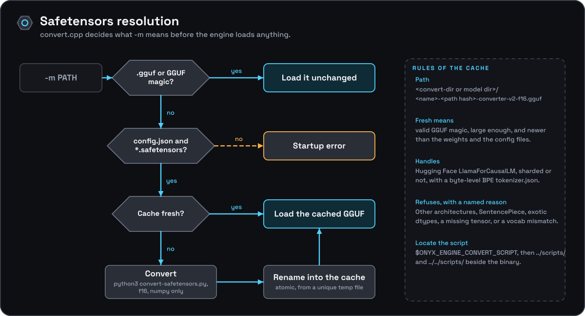

[Documentation](../README.md) › [Architecture](README.md) › Safetensors resolution and conversion

# Safetensors resolution and conversion

## Resolution steps

`main.cpp` calls `onyx_resolve_model(args, err)` (`src/convert.cpp`) before
`onyx_engine::load()` ever runs, and overwrites `args.model_path` with
whatever it returns:

1. **GGUF passthrough.** A `.gguf`-extension file, or any regular file
   starting with the `GGUF` magic bytes, is returned unchanged — no
   conversion involved.
2. **Safetensors detection.** Otherwise `-m` must be a directory containing
   `config.json` plus at least one `*.safetensors` file, or a
   `.safetensors` file whose parent directory satisfies the same; anything
   else is a startup error.
3. **Cache lookup.** The converted file lives at
   `<--convert-dir or model dir>/<model dir name>-<path hash>-converter-v2-f16.gguf`
   (`onyx-cache/` is used beneath the model directory when `--convert-dir` is absent)
   (the 8-hex-digit hash of the absolute source path keeps two models that
   share a directory name from colliding under a shared `--convert-dir`). It is
   reused if it has valid GGUF magic, is large enough, and is newer than the
   source weights and metadata files (mtime comparison) — so editing
   the source model (or its config) invalidates the cache automatically.
4. **Conversion.** On a cache miss, `resolve_converter_script()` locates
   `scripts/convert-safetensors.py` — via `$ONYX_ENGINE_CONVERT_SCRIPT` first,
   then paths relative to the running binary (`../scripts/`,
   `../../scripts/`), then (debug builds only) `ONYX_ENGINE_SOURCE_DIR` — and
   runs `python3 <script> <model_dir> --outfile <tmp> --outtype f16` via
   `popen`, streaming its combined output to stderr and keeping the last 20
   lines for the error message on failure. A successful run is atomically
   renamed into place from a unique temporary file in the cache directory.
5. **The converter itself** (`scripts/convert-safetensors.py`) is
   deliberately narrow: only the standard Hugging Face `LlamaForCausalLM`
   layout (`architectures`/`model_type` checked against
   `SUPPORTED_ARCHITECTURES`), optionally sharded via
   `model.safetensors.index.json`, with a byte-level BPE `tokenizer.json`
   (a SentencePiece `tokenizer.model` or any other tokenizer type is
   refused). It depends on nothing but `python3` + `numpy` — no
   `torch`/`transformers`, and nothing imported from the vendored llama.cpp
   tree — mapping HF tensor names to GGUF llama-arch names and writing the
   GGUF container format directly. Any structural mismatch (missing tensor,
   dtype it doesn't handle, vocab-size mismatch between `config.json` and
   `tokenizer.json`) raises a `ConvertError` with a specific message rather
   than producing a malformed GGUF.
