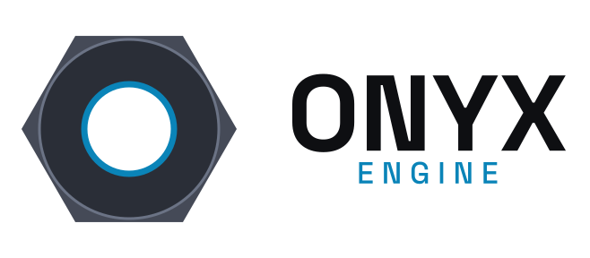
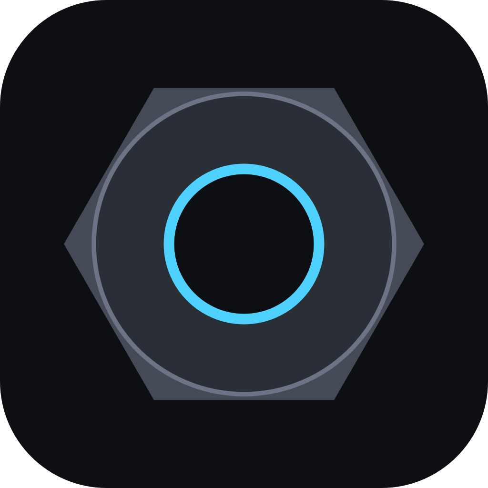

# Brand and logo

The Onyx Engine mark is a hex nut seen from above, with a cyan-lit bore: a
small, solid part that the rest of the machine is bolted to. All files live
in [`assets/logo/`](../assets/logo/).

<p align="center">
  <picture>
    <source media="(prefers-color-scheme: dark)" srcset="../assets/logo/svg/logo-on-dark.svg">
    
  </picture>
  &nbsp;&nbsp;&nbsp;
  
</p>

## Files

| File | Use |
| --- | --- |
| `svg/logo-on-dark.svg` | Primary logo on dark backgrounds |
| `svg/logo-on-light.svg` | Primary logo on white or light backgrounds |
| `svg/logo-mono-black.svg`, `svg/logo-mono-white.svg` | One-colour versions |
| `svg/mark.svg` | The nut alone, transparent background |
| `svg/icon.svg` | Square app icon / avatar: the nut on an onyx tile |
| `png/logo-*-{400,800,1600}w.png` | Raster logos at 400, 800 and 1600 px wide, transparent background |
| `png/mark-*.png`, `png/icon-*.png` | Mark and icon at 16, 32, 48, 64, 128, 180 (Apple touch), 192 (Android), 256, 512 and 1024 px |
| `pdf/logo-*.pdf` | Vector logos for print and slides |
| `favicon.ico` | 16, 32 and 48 px favicon |
| `social-preview.png` | 1280×640 GitHub social preview (set under *Settings → General → Social preview*) |

Use the SVGs wherever they are supported; text is converted to outlines, so
they render the same without the font installed.

## Colours

| Name | Hex | Role |
| --- | --- | --- |
| Onyx | `#0E0F12` | Dark background, icon tile, text on light |
| Graphite | `#2A2E37` | Nut face |
| Steel | `#454A57` | Nut body |
| Steel edge | `#6B7385` | Chamfer line |
| Cyan | `#4FD1FF` | Bore and "ENGINE" on dark |
| Deep cyan | `#0A84B8` | Bore and "ENGINE" on light |
| White | `#F2F4F8` | "ONYX" on dark |

## Type

"ONYX" is set in **Space Grotesk Bold** and the letter-spaced "ENGINE" in
Space Grotesk Medium (SIL Open Font License).

## Usage

- Keep clear space around the logo at least half the nut's width.
- Below about 160 px wide, use the mark or icon instead of the full logo.
- Don't rotate the nut, change its colours, or put the full-colour logo on a
  mid-grey or busy background; use the mono versions there.
- Don't set the name in another font or add effects (shadows, outlines,
  gradients).

## Regenerating

The pack is built from layered, editable [Vixl](https://github.com/jxburros/Vixl)
documents by [`assets/logo/build.py`](../assets/logo/build.py). With `vixl`
on `PATH` (it downloads Space Grotesk on first run):

```bash
python assets/logo/build.py            # rewrites assets/logo/ in place
python assets/logo/build.py /tmp/out   # or writes elsewhere
```

The output is deterministic, so an unchanged script produces no git diff.
