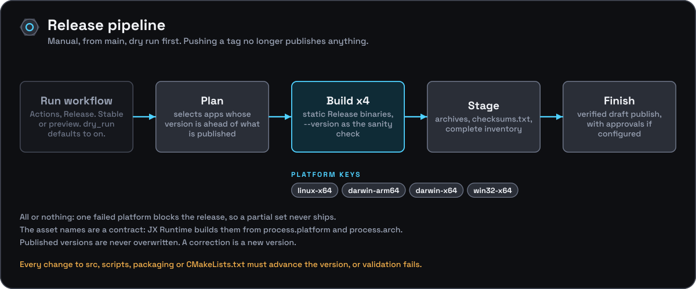

[Documentation](../README.md) › [Development](README.md) › Releasing

# Releasing



## How a release is cut

Releases are cut by hand from `main` through **Actions → Release → Run workflow** (`.github/workflows/release.yml`). Pushing a `v*` tag no longer publishes anything. Choose a channel (stable or preview) and leave **dry_run** on for the first pass; it defaults to on.

| Stage | Job | What it does |
|---|---|---|
| Plan | `plan` | Reads `release.json` and selects every app whose version is ahead of what is already published in its own tag namespace (`v`, `vendor-llama-cpp-v`, `vendor-ggml-v`). Fill in `app` to select just one. |
| Build | `build` ×9 | Stages the pinned llama.cpp source, configures a static Release build, builds `onyx-engine`, runs `--version`, checks the binary's dynamic dependencies, and packs the archive. |
| Stage | `release` | Downloads the nine archives, writes `checksums.txt`, and stages the complete configured inventory with the shared toolkit. |
| Finish | `publish-onyx-engine` | The shared `finish.yml` publishes a verified draft release (or only reports, under `dry_run`), subject to any configured approvals. |
| Image | `docker-onyx-engine` | Builds the CPU container image from the same SHA and checks `--version`. A real run pushes `ghcr.io/<owner>/onyx-engine:<version>` (and `:latest` on the stable channel) after the release is published; a dry run only builds. See [Docker](../guides/docker.md). |

The vendor packages ride the same workflow: when `vendor-llama-cpp` or `vendor-ggml` is ahead of its published version it is built, published to npm (`--provenance`, tag `next`; a dry run uses `npm publish --dry-run`) and released alongside.

`release-validation.yml` runs on every pull request to `main` and on every push to it. A change under `src/`, `scripts/`, `packaging/`, `third_party/` or `CMakeLists.txt` has to advance the version, and so does a docs-only change (the policy is `every-main-change`; patch by default). The shared infrastructure workflows are pinned to one commit, recorded in [`.release/README.md`](../../.release/README.md) with the credentials and checks that remain unverified.

To bump locally, obtain the pinned toolkit at `.toolkit`, then run:

```bash
node .toolkit/src/release.mjs bump --app onyx-engine
```

Then regenerate anything version-specific, write `.release/notes/onyx-engine/<version>.md`, and run the repository's checks. `release.json`, `package.json` and `package-lock.json` must agree; CMake reads the version from `package.json` through `.release/version.cmake`.

## What gets published

Each leg builds with `-DCMAKE_BUILD_TYPE=Release -DBUILD_SHARED_LIBS=OFF -DGGML_NATIVE=OFF -DGGML_OPENMP=OFF`, so `llama`, `llama-common`, `ggml` and `mtmd` link in statically and there are no separate `libllama` or `libggml` files.

| Platform key | Runner | CPU and GPU | Archive |
|---|---|---|---|
| `linux-x64` | `ubuntu-22.04`, for older-glibc portability | AVX2 | `onyx-engine-v<version>-linux-x64.tar.gz` |
| `linux-x64-baseline` | `ubuntu-22.04` | any x86-64 CPU | `onyx-engine-v<version>-linux-x64-baseline.tar.gz` |
| `linux-x64-vulkan` | `ubuntu-24.04` (glslc is packaged from 23.04; needs glibc 2.39) | AVX2 + Vulkan | `onyx-engine-v<version>-linux-x64-vulkan.tar.gz` |
| `linux-arm64` | `ubuntu-22.04-arm` | portable arm64 | `onyx-engine-v<version>-linux-arm64.tar.gz` |
| `darwin-arm64` | `macos-latest` (Apple Silicon) | arm64, CPU only (`CMakeLists.txt` forces `GGML_METAL` off unless `ONYX_ENGINE_METAL` is on) | `onyx-engine-v<version>-darwin-arm64.tar.gz` |
| `darwin-x64` | `macos-15-intel` | AVX2 | `onyx-engine-v<version>-darwin-x64.tar.gz` |
| `win32-x64` | `windows-latest`, MSVC | AVX2 | `onyx-engine-v<version>-win32-x64.zip` |
| `win32-x64-baseline` | `windows-latest`, MSVC | any x86-64 CPU | `onyx-engine-v<version>-win32-x64-baseline.zip` |
| `win32-x64-vulkan` | `windows-latest`, MSVC, LunarG Vulkan SDK 1.4.328.1 | AVX2 + Vulkan | `onyx-engine-v<version>-win32-x64-vulkan.zip` |

Each archive holds the binary plus `LICENSE`, `LICENSE-cpp-httplib` and `LICENSE-llama.cpp`, flat at the top level. `checksums.txt` has one `sha256sum`-style line (hex digest, two spaces, file name) per archive. The required list lives in `.release/config.json`.

**The names are a contract.** A key without a suffix is Node's `${process.platform}-${process.arch}`: JX Runtime's managed downloader (`jx-runtime backend install --engine onyx`) computes the asset name from it, so those names never change. The `linux-arm64` archive is published from 0.6.0; JX Runtime's downloader lists it from 1.5.9. The `-baseline` and `-vulkan` variants carry a suffix so that no downloader picks them by accident: a user or a supervisor asks for them by name. JX Runtime 1.5.9 does this deliberately: it takes `-baseline` when `/proc/cpuinfo` shows no AVX2 on Linux x64, and offers both through `backends.onyxengine.variant`.

Release builds disable host-native CPU tuning and OpenMP and carry no OpenSSL. Windows uses the static MSVC runtime. Standard operating-system C libraries are still required, and the Vulkan builds need the Vulkan loader (`libvulkan.so.1`, `vulkan-1.dll`), which GPU drivers install. The Linux and macOS legs fail the build if the binary links `libgomp`, `libssl`, `libcrypto` or anything under Homebrew. CUDA and ROCm archives are not built yet: their runtimes are large and version-specific, and which variants to ship is still open (see the [roadmap](../../ROADMAP.md#decisions-needed)). The [Docker guide](../guides/docker.md) has a CUDA image you can build yourself.

## The release is all-or-nothing, on purpose

The `release` job declares `needs: build` with no `if: always()`, so a single failing
platform blocks publication entirely. That is deliberate. JX Runtime derives
each asset's name from `${process.platform}-${process.arch}` against one
pinned tag, so a partial release installs cleanly on the platforms that built
and fails with a bare 404 on the ones that did not — a per-machine breakage
that looks like a network problem, from a release GitHub reports as green.
Failing the whole release makes the gap visible to the maintainer instead.

`fail-fast: false` on the build matrix is complementary rather than
contradictory: every platform still reports its own result, so one run shows
all the breakage at once rather than only the first failure.

## Lessons from the first release attempt

The first `v0.3.0` release run
([run 33906146774](https://github.com/JX-Holdings-LLC/Onyx-Engine/actions/runs/33906146774))
failed and, under the old tag-push workflow, **published a `v0.3.0` GitHub
Release with zero assets**. `linux-x64` and `darwin-arm64` built fine; the other two
legs did not, and `needs: build` correctly withheld the archives:

- **`win32-x64` failed at configure** with `CMake Error at CMakeLists.txt:3
  (project): Generator Visual Studio 17 2022 could not find any instance of
  Visual Studio.` The `windows-latest` image had moved past VS 2022, and the
  workflow pinned that generator by name. **Fix:** drop `-G` entirely and
  pass only `-A x64`, letting CMake select the newest installed Visual
  Studio. A pinned generator has to be updated on every runner-image roll;
  the default never does. The "Locate binary" step now probes both the
  multi-config (`build/Release/`) and single-config (`build/`) layouts and
  fails with an explicit error if neither holds a binary, instead of silently
  emitting an empty path.
- **`darwin-x64` was cancelled after 24 h queued** on `macos-13`, a runner
  label GitHub has retired. **Fix:** `macos-15-intel`, GitHub's supported
  x86_64 macOS image.
- **CI now configures and builds on Windows too**
  (`.github/workflows/ci.yml`, the `windows` matrix leg), so this class of
  failure is caught on a pull request rather than during a release. That leg
  is configure + build + `--version` only; the test scripts are POSIX shell
  and are not run there.
- **The first Windows CI run then found that `src/convert.cpp` had never
  compiled under MSVC** (`<sys/wait.h>`, `popen`/`WIFEXITED`, `/proc/self/exe`,
  `python3`). The generator fix was correct — all of llama.cpp built — and
  the converter launcher is now ported (`_popen`/`_pclose`, cmd.exe
  quoting, `GetModuleFileNameW`, `python`), so the Windows leg is the
  proof that a `win32-x64` release asset can be built at all.

## The v0.4.1 and v0.5.1 publish failures

Both live runs got through plan, build and stage, then failed in `publish-onyx-engine`
([run 39829737521](https://github.com/JX-Holdings-LLC/Onyx-Engine/actions/runs/39829737521) for v0.5.1)
with `gh: Not Found (HTTP 404)` on `gh api repos/JX-Holdings-LLC/Onyx-Engine/releases/tags/v0.5.1`.
The publisher at infrastructure commit `181636b` created the draft and then fetched it with
`GET releases/tags/{tag}`. That endpoint returns only published releases, so a draft always comes back
404. Each failed run left a tag and an empty draft behind (`v0.4.1`, `v0.5.1`).

**Fix:** move both pins to `d7f42f9`. From that commit the toolkit finds drafts in the release
list and retries for up to 15 seconds while a new draft shows up there. The new pin brings two other
changes: a plan that selects nothing fails and names the reason, and a release's notes cover every
version after the last published one (here, everything after v0.4.0). The stale `v0.4.1` and
`v0.5.1` drafts and tags are not reused, because the next release has a higher version. Delete
them by hand when convenient.

Whether a given release carries all nine archives and `checksums.txt` is visible on its
[Releases](https://github.com/JX-Holdings-LLC/Onyx-Engine/releases) page. The unified
workflow has no recorded dry run yet; the [roadmap](../../ROADMAP.md#now) lists it as the first item to close.
