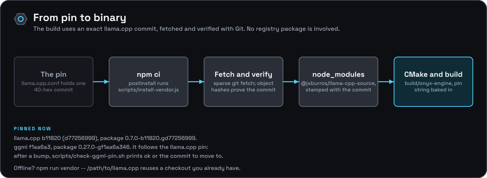

[Documentation](../README.md) › [Development](README.md) › Vendoring llama.cpp and ggml

# Vendoring llama.cpp and ggml



For maintainers upgrading or publishing a vendored source tree. Consumers just run `npm ci`; see [building](building.md).

## Vendor specs

What gets vendored is described by a **spec**, one file per upstream in
`packaging/vendor/`:

| Spec              | Package                      | Used by                                   |
| ----------------- | ---------------------------- | ----------------------------------------- |
| `llama.cpp.conf`  | `@jxburros/llama-cpp-source` | onyx-engine                               |
| `ggml.conf`       | `@jxburros/ggml-source`      | the BackTrack audio apps (standalone ggml) |

Each spec is a list of `KEY="value"` lines: the upstream repository, the
full 40-hex commit, upstream's own version (and build number, for
llama.cpp), the npm package name, the directories a fresh fetch checks out,
the paths pruned from the staged tree, the paths copied back after pruning,
and the paths an installed tree must contain. Four readers parse it —
`packaging/make-vendor-package.sh` and `scripts/vendor.sh` (sourced as Bash
through `packaging/vendor/lib.sh`), `scripts/install-vendor.js`, and
`CMakeLists.txt` — so it stays one value per line, no expansions.

The scripts themselves carry nothing specific to llama.cpp, so another
repository reuses `packaging/make-vendor-package.sh`,
`packaging/vendor/lib.sh`, `scripts/vendor.sh` and `scripts/install-vendor.js`
unchanged, adding its own spec and listing it in its `package.json`'s
`"vendor"` array (`["llama.cpp"]` here, `["ggml"]` in BackTrack).

**The ggml pin follows the llama.cpp pin.** `ggml.conf` pins the ggml
revision the llama.cpp pin last synced (recorded upstream in llama.cpp's
`scripts/sync-ggml.last`), so a ggml fix or a new GPU backend reaches
onyx-engine and the audio apps together. After moving the llama.cpp pin,
run:

```bash
scripts/check-ggml-pin.sh                 # checks packaging/vendor/ggml.conf
scripts/check-ggml-pin.sh ../BackTrack/packaging/vendor/ggml.conf
```

It prints `ok`, or the ggml commit to move to and exits 1.

## Building a package

```bash
packaging/make-vendor-package.sh [--spec NAME|FILE] [path-to-upstream-checkout]
```

- **Spec.** `--spec` names a file in `packaging/vendor/` (`llama.cpp`, the
  default, or `ggml`) or gives a path to one.
- **Pin.** For llama.cpp: commit `d77256999f211f8c0a5b12d13564f48d685b59e7`,
  build `b11820`, package version `0.7.0-b11820.gd77256999`. For ggml:
  commit `f1aa6a3465ffad40dadd390ac16b9deedd4e97f7`, package version
  `0.27.0-gf1aa6a346`. The version is always
  `<upstream version>[-b<build>].g<9-char commit>`.
- **Source.** With a path, it stages from that local checkout (which must
  be at the pinned commit). Without one, it does a depth-1 `git fetch` of
  the pinned commit, sparse to the spec's directories, into
  `packaging/dist/<spec>/` — the only step that needs network access.
- **Pruning.** For llama.cpp: `docs/`, `tests/`, `examples/`, `benches/`,
  `media/`, `pocs/`, `ci/`, `app/`, `conversion/`,
  `requirements/`/`requirements.txt` and `.github`/`.devops` are removed, and
  so are all of `models/` except `ggml-vocab-llama-spm.gguf` (the vocab file
  `scripts/make-tiny-model.py` reads) and everything under `tools/` except
  `tools/mtmd` — `onyx-engine` builds exactly one thing out of `tools/`, the
  `mtmd` library (via `LLAMA_BUILD_MTMD=ON`, which `add_subdirectory()`s
  `tools/mtmd` directly); its `CMakeLists.txt` links `vendor::hash`,
  `vendor::miniaudio`, `vendor::stb` and `vendor::sheredom`, all under
  `vendor/` and kept. For ggml: everything but `cmake/`, `include/`, `src/`
  and the top-level files.
- **`.gitignore` stripping.** `npm pack` honors any `.gitignore` files it
  finds unless a `.npmignore` is present, and upstream's `.gitignore` would
  silently drop files the package needs (e.g. `*.gguf`). The script deletes
  every `.gitignore` in the staged tree and writes a minimal `.npmignore`.
- **Package metadata.** The staged tree gets a `.vendor-source-commit`
  stamp and a `package.json` (name, version, description, license,
  `homepage`, `repository`, plus `vendorName`/`vendorCommit`/`vendorUpstream`
  recording provenance), then `npm pack` produces
  `packaging/dist/<spec>/<package>-<version>.tgz`.

`scripts/vendor.sh [--spec NAME] [path]` runs the same build and extracts the
tarball into `node_modules/<package>`; `--install-only` skips the build and
installs a tarball already in `packaging/dist/<spec>/` (CI restores it from
its cache).

## Publishing (`.github/workflows/publish-vendor.yml`)

Publishing is automated: `.github/workflows/publish-vendor.yml`,
`workflow_dispatch`-only with a `spec` choice (`llama.cpp` or `ggml`) and a
`dry_run` boolean input (default `true`), runs
`packaging/make-vendor-package.sh --spec <spec>` to build the tarball,
checks `npm view <package>@<version>` and skips with a notice if that exact
version is already on the registry (so re-dispatching after a successful
publish is a no-op, not an error), and otherwise runs

```bash
npm publish packaging/dist/<spec>/<package>-<version>.tgz --access public --provenance
```

(with `--dry-run` appended when `dry_run` is `true`).

**One-time setup**, before the first real run:

1. Create an npm **granular access token** with publish rights scoped to
   `@jxburros`, and store it as this repo's `NPM_TOKEN` secret (Settings →
   Secrets and variables → Actions) — this is what
   `actions/setup-node@v4`'s `registry-url` plus the workflow's
   `NODE_AUTH_TOKEN` env var authenticate with. **Or**, skip the token
   entirely and set up [npm Trusted
   Publishing](https://docs.npmjs.com/trusted-publishers) for this
   repository and the `publish-vendor.yml` workflow — npm then accepts the
   OIDC identity the workflow already requests (`permissions: id-token:
   write`, needed for `--provenance` regardless) instead of a stored
   secret.
2. If `@jxburros` isn't available to you, rename it: it is the `PKG_NAME`
   line of each spec in `packaging/vendor/`, and the
   `node_modules/@jxburros/llama-cpp-source` path `CMakeLists.txt` and the
   workflows look in.

**To run it:** Actions → `publish-vendor` → Run workflow. Run it once with
`dry_run` left `true` (checked into the input default) to exercise the
whole path — build, version check, `npm publish --dry-run` — without
actually publishing, then run it again with `dry_run` set to `false`.

**When to run it again:** only when a pin in `packaging/vendor/` changes (a
new commit means a new package version), not on every push — the
version-check step makes an accidental extra dispatch harmless either way.

Publishing the package is optional: a clean build never needs it. `npm ci` fetches and verifies the pinned Git commit directly, and the committed `package-lock.json` records the local install script.

The unified [Release workflow](releasing.md) also builds and publishes these packages (to npm with provenance, tag `next`) when `vendor-llama-cpp` or `vendor-ggml` is ahead of its published version in `release.json`. `publish-vendor.yml` is the manual, single-spec route to the same end.
