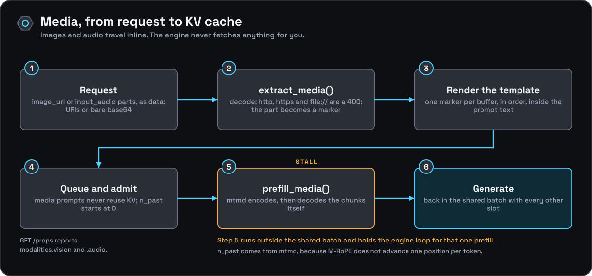

[Documentation](../README.md) › [Guides](README.md) › Multimodal input

# Multimodal input

Images, and audio when the projector supports it, go in through chat completions. The engine needs two files: the language model, and a multimodal projector (`mmproj`) GGUF that matches it.

## Start the server

```bash
onyx-engine -m ./models/vision-model.gguf --mmproj ./models/vision-model-mmproj.gguf --alias vision
curl http://127.0.0.1:8080/props
```

`GET /props` reports what the projector can do:

```json
"modalities": {"vision": true, "audio": false}
```

Both are `false` when no projector is loaded. With a projector loaded, `--cache-reuse` and `--context-shift` are forced off for the whole process and a warning goes to stderr, because a media chunk's cache positions can be neither prefix-matched nor partly discarded.

## Send an image

Media goes inline, as a `data:` URI or bare base64. Never a URL:

```bash
IMG=$(base64 -w0 photo.png)        # on macOS: base64 -i photo.png
curl http://127.0.0.1:8080/v1/chat/completions -H 'Content-Type: application/json' -d @- <<JSON
{"messages": [{"role": "user", "content": [
  {"type": "text", "text": "What is in this picture?"},
  {"type": "image_url", "image_url": {"url": "data:image/png;base64,$IMG"}}
]}]}
JSON
```

Audio, for a projector that supports it:

```json
{"type": "input_audio", "input_audio": {"data": "<base64>", "format": "wav"}}
```

## What is refused, and why

| Request | Result |
|---|---|
| `http://`, `https://` or `file://` as a URL | `400`. The engine never reads a network or a file on a request's behalf; inline the bytes. |
| A media part with no data, or a malformed `data:` URI | `400` |
| An image to a server started without `--mmproj` | `400` |
| An image to a projector without vision, or audio to one without audio | `400` (check `/props`) |
| A decoded input that does not match its marker, or a media prompt that does not fit the slot | an error naming the cause |

Video is off by design: that path shells out to `ffmpeg`, and the engine takes no runtime dependency on another process.

## What it costs

Encoding the image runs inside the engine loop, at the moment the request is admitted to a slot. While that prefill runs, other slots wait; their cached state is untouched, and they resume when it finishes. With `-np 1` there is nothing to stall. With several slots serving mixed traffic, expect a visible hiccup in the streams of the others every time an image request arrives.



Media prompts never reuse the cache. Mechanism and reasoning: [multimodal architecture](../architecture/multimodal.md).
