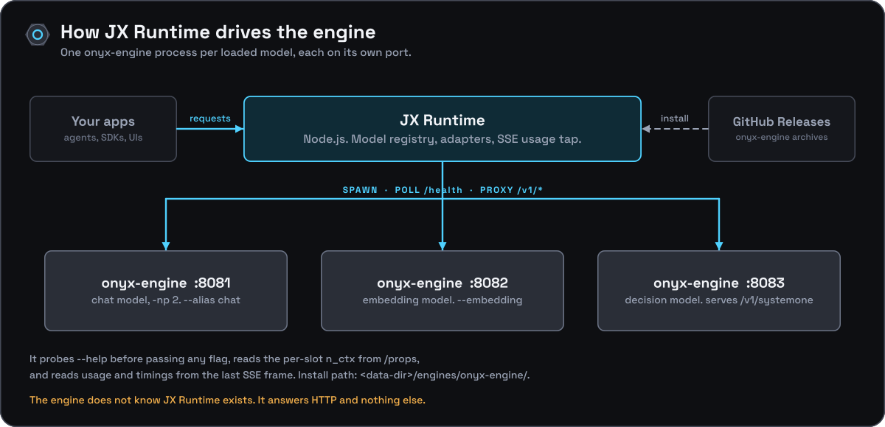

[Documentation](../README.md) › JX Runtime integration

# JX Runtime integration

[JX Runtime](https://github.com/jxburros/JX-Runtime), a Node.js model runtime, is Onyx Engine's first-class integration. It spawns `onyx-engine` where it would otherwise spawn a third-party `llama-server`: one process per loaded model, polled at `GET /health`, with its OpenAI-compatible endpoints proxied through to callers.

JX Runtime has no private contract. Everything this page lists is public behaviour, and every item is on the [stability page](../reference/stability.md); anyone writing their own supervisor gets the same guarantees (see [supervising](../guides/supervising.md)).

This page is the contract from the engine's side. It maps what JX Runtime's `llamacpp` adapter does against upstream `llama-server` onto what `onyx-engine` provides, and it states what the `onyxengine` adapter relies on. The adapter's own code lives in the JX Runtime repository, not here; read every "the adapter does X" below as "the adapter calls this, and the engine is built to answer the same way".

## The two halves

| Half | Where | What it is |
|---|---|---|
| The engine | this repository | `onyx-engine`, a single-model HTTP server |
| The adapter | JX Runtime, `src/backends/onyxengine.js` | selected with `execution.backend: 'onyxengine'`, configured under `backends.onyxengine.*` |
| The installer | JX Runtime, `jx-runtime backend install --engine onyx` | downloads a prebuilt engine from this repository's [Releases](https://github.com/JX-Holdings-LLC/Onyx-Engine/releases) into `<data-dir>/engines/onyx-engine/`, pinned to a release tag and the asset-name scheme in [releasing](../development/releasing.md#what-gets-published) |

## Endpoints the adapter calls

JX Runtime talks to its child process over a small, fixed set of endpoints. The engine implements all of them; exact shapes are in the [API reference](../reference/api/README.md).

| Adapter step | Route | What the engine guarantees |
|---|---|---|
| Wait for readiness (`_waitReady()`) | `GET /health`, with exponential backoff from 25 ms to 300 ms | `503 Loading model` while loading, then `200 {"status":"ok"}`. Only a `200` means the model is loaded; the adapter keeps polling on anything else, and stops on process exit. See [readiness](#readiness). |
| Capture properties at load (`_captureProps()`) | `GET /props` | `chat_template`, `build_info`, and the context length under **both** `n_ctx` and `default_generation_settings.n_ctx`, the same value. See [per-slot context](#per-slot-context). |
| Count tokens for preflight (`tokenCount()`) | `POST /tokenize` with `{"content": ...}` | Returns `{"tokens": [...]}`. |
| Render a prompt (`renderPrompt()`) | `POST /apply-template` with a chat-completions-style body | Returns `{"prompt": "..."}`. |
| Proxy inference (`KIND_PATHS`) | `/v1/chat/completions`, `/v1/completions`, `/v1/embeddings` | Served exactly there. |
| Proxy decisions | `POST /v1/systemone` | Served for a decision model; see [decision models](#decision-models). |

All of these calls except the streaming proxy go through a small, bounded, best-effort JSON fetch. Any non-200, timeout or unparseable response is treated as "the engine did not say", never a hard error. An engine that omits or changes one of these routes therefore degrades gracefully in the adapter instead of failing loads, but the value that route provided (a recorded template hash, preflight counts) is lost.

### Per-slot context

`GET /props` reports the **per-slot** context under `n_ctx`, matching `llama-server`, whose `default_generation_settings.n_ctx` is its own `n_ctx_slot()`. The adapter depends on this: it launches with `-c contextLength * slots` and always passes `--parallel`, so it expects `/props` to hand back the per-slot `contextLength` it asked for. Because `--parallel N` divides the context, reporting the undivided figure would tell the adapter a request has `N` times the window it really has, and preflight would admit prompts the engine then refuses with `prompt (N tokens) does not fit in the context window`. The undivided value is available as `n_ctx_total`, which the adapter does not read.

### Decision models

JX Runtime proxies `POST /v1/systemone` for decision ("System One") models, and the `onyxengine` adapter inherits the route from the `llamacpp` adapter. The engine serves it for a model with `<arch>.decision.type` in its metadata, with llama-server's request and response shapes, so the adapter needs no change to send `decide` loads to Onyx.

Such a process serves only that route: chat and completions answer `501`, and `/props` carries `"decision_type": "<family>"` (`null` for other models), which the adapter can use to tell the two apart. A text model answers `/v1/systemone` with `501`, which the adapter already surfaces as "engine does not provide /v1/systemone". Image input needs `--mmproj` and one of the families listed in [decision models](../guides/decision-models.md#images).

## Readiness

From 0.6.0 the engine binds its port before it loads the model and answers `503` with
llama-server's loading body (`{"error":{"code":503,"message":"Loading model","type":"unavailable_error"}}`)
on `/health` and every other route until the model is up. Earlier versions kept the port closed
until then.

The adapter's `_waitReady()` already treats only `res.ok` as ready and retries on any other
status or a refused connection, while checking whether the process has exited. It therefore works
unchanged against both behaviours, and against `llama-server`, which answers the same `503`.
From 1.5.3, JX Runtime also records when the engine first answered `503`
(`stages.firstHealthLoadingMs`), separating "process started and port open" from "model loaded" in
its load telemetry.

The engine prints the bound port on stderr (`onyx-engine listening on http://HOST:PORT (loading)`)
and in `/props` (`port`), so `--port 0` is available to a supervisor that wants the operating
system to choose. JX Runtime still chooses the port itself and passes it.

## `--alias` is the model identity

JX Runtime passes `--alias <registry model id>` to the engine so that OpenAI-compatible responses echo the runtime's own model id instead of the blob path given to `-m`. The engine's `--alias` sets the id that `/v1/models`, `/v1/chat/completions`, `/v1/completions` and `/v1/embeddings` all report. Without it the engine derives an id from the file name (stripping directories, trailing slashes and `.gguf` or `.safetensors`; a safetensors directory uses its directory name). An integration should always pass `--alias` explicitly rather than rely on that derivation.

## Version and help probing

The adapter never assumes a capability; it probes for it.

- **`detectSupport()`** runs `<binary> --version` with a 5 s timeout to confirm the binary starts and to read a version string. It distinguishes "could not spawn" and loader or library failures from "answered but exited non-zero", and treats the latter leniently. `onyx-engine --version` prints `onyx-engine <version>`, then `llama.cpp <build>-<commit>`, and exits `0`.
- **`supportsJinja()`, `supportsMmproj()` and the generic `supportsFlag(flag)`** run `<binary> --help` once (cached per binary) and search the output for a flag name before ever passing that flag on a real launch. An older `llama-server` exits during argument parsing on an unrecognized flag, which would turn "we tried a newer feature" into "the model failed to load". The `onyxengine` adapter overrides `supportsJinja()` to answer `true` without spawning `--help`, and its `buildArgs()` always adds `--jinja` to a launch that is not embedding-only, because the engine always accepts it.

That is why the engine's `--help` is curated rather than generated: **the parser and `--help` move together, always.** A flag never appears in one without the other (see the header comment in `src/args.h`). `supportsFlag('--mmproj')`, `('--context-shift')`, `('--reasoning-budget')` and `('--parallel')` all come back `true`, because all four are real, and the adapter's own "only pass a flag the build advertised" logic then sends them without special-casing Onyx. Any future flag must be added to `--help` and the parser together so the same probe picks it up with no adapter change.

What passing each one buys:

- **`--mmproj PATH`** makes `image_url` and `input_audio` parts acceptable on chat completions (as `data:` or base64 payloads only) and lets `/props` report real `modalities`. It also forces `--cache-reuse` and `--context-shift` off process-wide; an adapter that raises all three on a multimodal launch sees the latter two silently overridden, with a warning on stderr, not a launch failure.
- **`--context-shift`** lets a slot that fills its context keep generating by dropping its oldest unprotected tokens instead of finishing with `length`. `--keep N` sets how much of the front survives a shift.
- **`--reasoning-budget N`**, with `--reasoning-budget-message` and the per-request `reasoning_budget_tokens`, caps or suppresses a thinking model's `<think>` block, bounding latency and token spend without model-specific prompt engineering.
- **`--parallel N`** allocates `N` real request slots served by one continuous-batching loop. The adapter passes `--parallel` on every launch, unconditionally, so that the slot count is stated rather than inherited from an engine default. Because `N` divides the context, an adapter that raises `--parallel` should raise `-c` to match.

Two probe details matter to correctness, not just capability:

- **`--flash-attn` takes a value, never a bare toggle.** The adapter's `flashAttnStyle()` probe tells `-fa on|off|auto` (value form) from a bare `-fa` toggle by matching the help line against `/on\|off\|auto|'on'/`. The engine accepts only the value form, and a bare `-fa` exits with `error: -fa requires a value`, so a probe that classified it as a toggle would break every launch with flash attention on. The help line therefore reads `on|off|auto` with pipes, not commas, which is what the regex needs. The `onyxengine` adapter also overrides the probe outright (`async flashAttnStyle() { return 'value'; }`), as it does `supportsJinja()`, so the pipe form matters for anything that runs the generic probe: the `llamacpp` adapter pointed at an engine binary, or a future adapter that drops the override.
- **`--no-webui` is accepted and ignored.** The `llamacpp` adapter passes it on every launch; the engine accepts it as a compatibility no-op so a hand-configured launch that reuses `llama-server` arguments does not fail at parsing. The `onyxengine` adapter strips it instead of relying on that.

## Usage and timing accounting

JX Runtime's `StreamUsageObserver` (`src/sseUsage.js`) is a passive, read-only tap on the SSE byte stream being forwarded to the client. It looks for `data:` lines whose JSON contains a `usage`, `timings` or non-null `finish_reason` key. When it finds one it:

- reads `usage.prompt_tokens` and `usage.completion_tokens` as the reported counts (a later usage frame supersedes an earlier one, because engines send the authoritative totals last);
- reads `choices[0].finish_reason`;
- reads `timings.prompt_ms`, `predicted_ms`, `prompt_per_second` and `predicted_per_second`.

If no usage frame ever arrives, it falls back to counting frames that carried non-empty `content` or `text` (one frame is about one token, marked `estimated: true`).

The engine's final SSE frame, for both `/v1/chat/completions` and `/v1/completions`, carries exactly those fields: a top-level `usage` with `prompt_tokens`, `completion_tokens` and `total_tokens`, and a top-level `timings` with `prompt_ms`, `predicted_ms`, `prompt_per_second` and `predicted_per_second`, plus `cache_n`, `prompt_n` and `predicted_n`, which the observer ignores without choking. The observer therefore records exact counts, not estimates, against a real engine stream.

## Process lifecycle

| Event | Engine behavior | Adapter's job |
|---|---|---|
| Spawn | Parses arguments, binds, then resolves and loads the model (`/health` answers `503` meanwhile) | Pass `--alias`, `--port`, `-c`, `--parallel` and only the feature flags the build advertises |
| Ready | `/health` returns `200` | Poll with backoff; treat `503` and a refused connection as "not yet", and process exit as failure |
| Failed load | Prints `error: ...`, closes the port, exits 1 | Report the stderr tail |
| Request | Queues FIFO, decodes in a shared batch | Proxy; read `usage` and `timings` from the last frame |
| Client disconnect | The request is cancelled at the next tick and its slot freed | Close the upstream connection promptly |
| Unload | Process is signalled and exits | Free the port; there is no in-process unload |

The engine holds the model for the life of the process. Swapping models means starting another process, which is exactly the registry bookkeeping the adapter already does for `llama-server`.

## Changing the contract

Anything above that JX Runtime reads is part of the public contract on the [stability page](../reference/stability.md): the routes, the `/props` fields, the final-frame fields, the readiness answers, the asset names and the `--help` rule. A change to one follows that page's rule (a minor version and a **Breaking** changelog heading). Check the adapter as well, so the JX Runtime side can move its pin deliberately.
