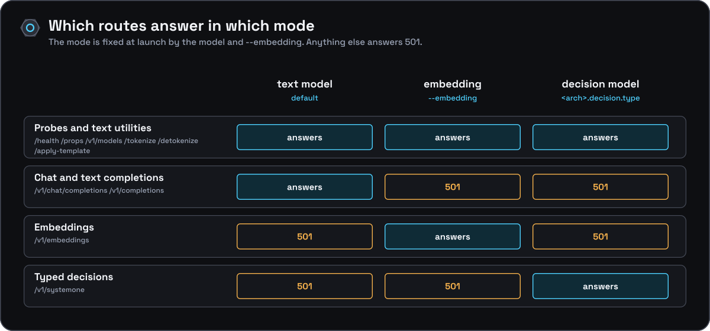

[Documentation](../../README.md) › [Reference](../README.md) › API reference

# API reference

Every request and response body is JSON. These pages describe exactly what `src/server.cpp` parses and returns: not the whole OpenAI surface, only the subset onyx-engine implements. Refusals are collected in [compatibility and limits](../compatibility.md).

## Routes

| Method | Path | Purpose | Page |
|---|---|---|---|
| `GET` | `/health` | Liveness; exempt from `--api-key` | [service endpoints](service-endpoints.md#get-health) |
| `GET` | `/props` | Model and build metadata | [service endpoints](service-endpoints.md#get-props) |
| `GET` | `/v1/models` | OpenAI-style model list (always exactly one) | [service endpoints](service-endpoints.md#get-v1models) |
| `POST` | `/tokenize` | Text to token ids | [service endpoints](service-endpoints.md#post-tokenize) |
| `POST` | `/detokenize` | Token ids to text | [service endpoints](service-endpoints.md#post-detokenize) |
| `POST` | `/apply-template` | Render a chat prompt without generating | [service endpoints](service-endpoints.md#post-apply-template) |
| `POST` | `/v1/chat/completions` | Chat completion, streaming or not | [chat completions](chat-completions.md) |
| `POST` | `/v1/completions` | Text completion, streaming or not | [text completions](completions.md) |
| `POST` | `/v1/embeddings` | Pooled embeddings (only with `--embedding`) | [embeddings](embeddings.md) |
| `POST` | `/v1/systemone` | Typed decisions (only for a decision model) | [decision models](systemone.md) |

## Which routes answer

<a id="which-routes-answer"></a>

The mode is fixed at launch by the model and by `--embedding`. A route the mode does not serve answers `501` with `type: "not_supported_error"` and a message that says what to start instead.



## Authentication

If `--api-key KEY` was passed, every route except `GET /health` (and
`OPTIONS` preflight requests) requires header:

```
Authorization: Bearer KEY
```

A missing or wrong value returns `401` with the standard error shape (below),
`type: "authentication_error"`. If `--api-key` is not set, no auth is
enforced anywhere.

## Error shape

Every error response (auth failures, bad requests, internal errors, and the
`501`s for endpoints disabled by mode) has the same JSON shape:

```json
{
  "error": {
    "message": "human-readable description",
    "type": "invalid_request_error | authentication_error | server_error | not_supported_error",
    "code": 400
  }
}
```

`code` mirrors the HTTP status. Unhandled C++ exceptions are caught by a
global exception handler and reported as `500`/`server_error` with the
exception's `what()` as `message`.

## Browser origins, headers and timeouts

A request that carries an `Origin` header is refused with `403` (`browser-origin requests are disabled`) on every route, `/health` included, and before the API-key check. `OPTIONS` also returns `403`. There is no CORS configuration: put a proxy you control in front if a browser must call the engine.

Responses carry `Server: onyx-engine/<version>`. The read timeout is 30 seconds (or `--timeout`, if lower): a client that sends nothing for that long while its request is incomplete (cpp-httplib v0.62 also bounds the whole request line and headers by it) is disconnected, so slow or idle clients cannot hold the worker threads. The write timeout is `--timeout`, 600 seconds by default, since a stream can go quiet while a long prompt is processed. An HTTP worker waits on its own request, so a long generation holds one worker thread, not the engine.

The HTTP layer is cpp-httplib v0.62.0, which parses requests strictly: an HTTP/1.1 request without a `Host` header, or with a malformed request line, gets `400` before any route sees it. A request body that nests arrays and objects deeper than 64 levels is refused with `400` (`invalid_request_error`) before it is parsed.
