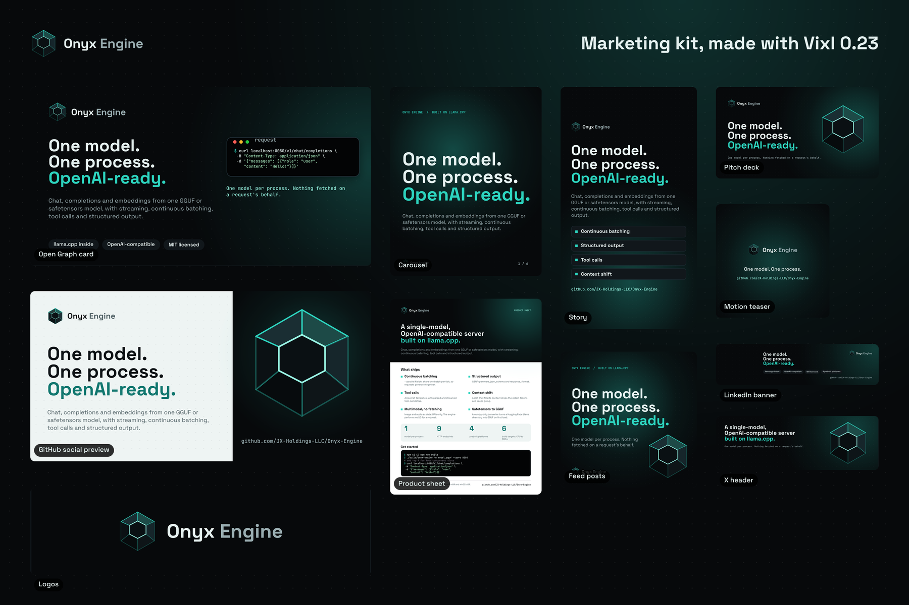
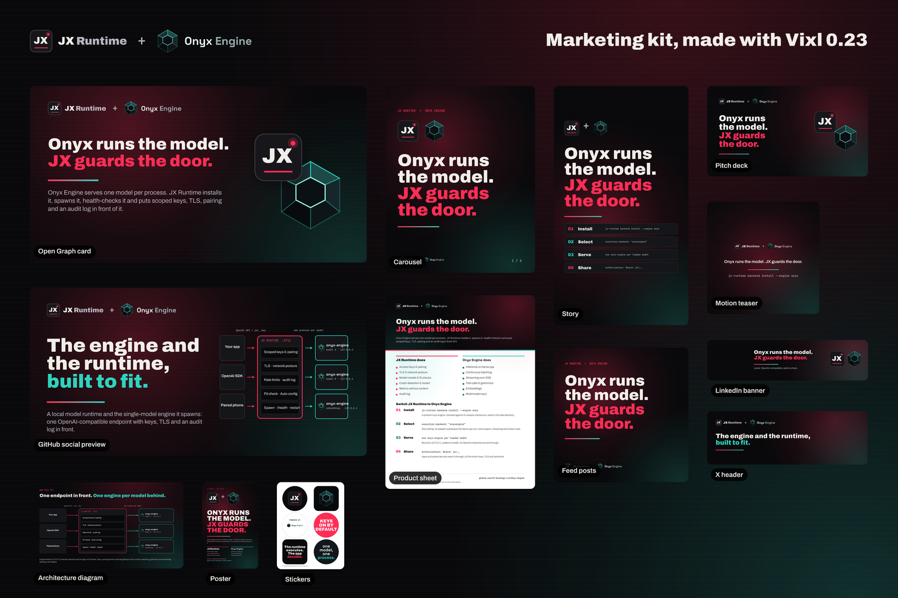

# Marketing kits

Marketing material for Onyx Engine, and for JX Runtime and Onyx Engine together, made with
[Vixl](https://github.com/jxburros/Vixl) 0.23.0. One script, [`build.py`](build.py), builds every piece
through Vixl's Python API: logos, social cards, feed posts, carousels, pitch decks, print sheets, a
poster, stickers and motion teasers. Nothing was drawn by hand or in another app.

The same `build.py` lives in the JX-Runtime repository's `marketing/` folder. Each repository keeps its own
kit plus the joint kit; edit the script in one place and copy it to the other.

| Kit | Folder | Overview |
| --- | --- | --- |
| Onyx Engine | [`output/onyx-engine/`](output/onyx-engine/) |  |
| Together | [`output/together/`](output/together/) |  |

## What's in it

Onyx Engine kit (`output/onyx-engine/`):

| Piece | Files | Notes |
| --- | --- | --- |
| Logos | `logos/`: mark and lockup on dark, light and transparent grounds, PNG and SVG | Vector shapes defined in `build.py` |
| Open Graph card | `social/og-card-1200x630.png` | Link previews |
| GitHub social preview | `social/github-preview-1280x640.png` | Repository Settings → Social preview |
| LinkedIn banner | `social/linkedin-banner-1584x396.png` | Left fifth kept quiet for the profile picture |
| X header | `social/x-header-1500x500.png` | |
| Story | `social/story-1080x1920.png` | Top and bottom 250 px kept clear of platform UI |
| Feed posts | `social/post-1-statement-1080.png`, `post-2-features-1080.png`, `post-3-get-started-1080.png` | 1080 × 1080 |
| Carousel, 6 slides | `carousel/`: PDF, one PNG per slide, contact sheet | 1080 × 1350 |
| Pitch deck, 8 slides | `deck/onyx-engine-pitch-deck.pdf`, `.pptx` (editable), `.html` (presenter) | Speaker notes on most slides |
| Product sheet | `print/one-pager-letter.pdf` (vector) and PNG | US Letter |
| Motion teaser | `motion/teaser.mp4`, `teaser.gif`, poster frame, contact sheet | 6.6 s, 1080 × 1080 |

Joint kit (`output/together/`): Open Graph card, GitHub preview, LinkedIn banner, X header, story,
three feed posts (statement, who does what, switching engines), an architecture diagram (PNG, SVG, PDF),
a six-slide carousel, a seven-slide deck (PDF, PPTX, HTML), a product sheet, a tabloid poster
(CMYK PDF with bleed), a sticker sheet and a motion teaser.

Every piece also has its editable `.vixl` master next to its exports, and a `.check.json` with the
`vixl check` findings it was released with. None of them is a `fix` finding; the rest are informational.

## Rebuild

With Vixl 0.23.0 or newer (`python -m pip install "vixl-engine[pdf] @ https://github.com/jxburros/Vixl/archive/refs/tags/v0.23.0.tar.gz"`):

```bash
python marketing/build.py                    # this repository's kit plus the joint kit
python marketing/build.py --kit together     # one kit
python marketing/build.py --kit onyx og deck   # some pieces of one kit
```

Fonts (Archivo, Space Grotesk, JetBrains Mono) download from Google Fonts on the first run and are
embedded in each master. The MP4 teasers need `ffmpeg`. A full build takes about three minutes.

## How it's built

- **JX Runtime** takes its palette and type from its own web UI (`src/ui/index.html` in JX-Runtime):
  carbon blacks, chrome text, the crimson `#FF2D55` accent and Archivo. Its mark is a carbon module with
  a JX monogram and a lit status LED.
- **Onyx Engine** is the black stone: near-black with a teal `#2DD4BF` accent and Space Grotesk. Its mark
  is a faceted hexagonal gem whose facets are edged in teal light.
- **Together** keeps JX Runtime's carbon and type and carries both accents, joined by a crimson-to-teal
  bar wherever the runtime meets the engine.
- **Copy** is taken from the two READMEs and docs as of JX Runtime 1.4.4 and Onyx Engine 0.4.0, and
  states the current limits where they matter (JX Runtime is alpha and its release binaries are not
  yet code-signed). The `COPY` and `JOINT` tables at the top of `build.py` hold every claim; update them
  when the products change and rebuild.
- **Counts** quoted in the copy: JX Runtime has one required production dependency (`express`), four
  connectivity modes (`local`, `lan`, `private-network`, `tunnel`) and four engine backends (llama.cpp,
  Onyx Engine, MLX, vLLM). Onyx Engine has nine HTTP endpoints, prebuilt archives for four platforms and
  six build targets (CPU, CUDA, Vulkan, Metal, ROCm/HIP, BLAS).
